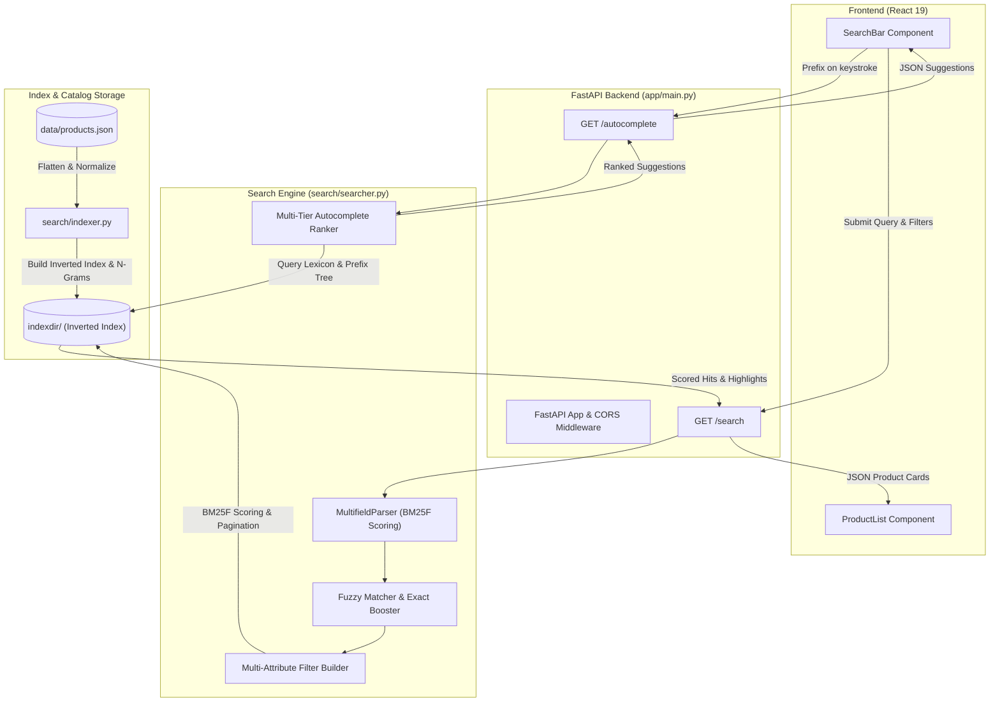
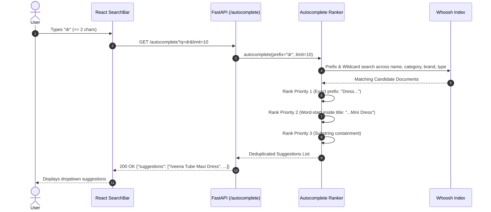

# How It Works: E-Commerce AI-Integrated Search Engine

An in-depth guide to the architecture, data pipeline, indexing engine, search ranking algorithms, and frontend integration of the E-Commerce AI Search Bar.

---

## 1. High-Level Architecture

The system connects a React.js client interface to a high-speed Python search backend powered by **FastAPI** and the **Whoosh** full-text search indexing engine.



---

## 2. Ingestion & Indexing Pipeline (`search/indexer.py`)

Before any product can be queried in milliseconds, the raw catalog data in `data/products.json` is transformed and indexed.

### Ingestion Flow:
1. **Catalog Loading:** Reads `data/products.json` with UTF-8 decoding.
2. **Flattening Product Variants:** E-commerce products have parent attributes (product title, brand, category, gender) and child variants (variant ID, color list, size list, price, image URL, stock status). `flatten_record()` produces a flattened document for every variant (`{product_id}-{variant_id}`).
3. **Synthetic Full-Text Generation:** Hyphenated and delimited terms (e.g., `western-dresses`, `uk-08-s`) are normalized and concatenated into a unified `full_text` field:
   ```python
   full_text = " ".join([product_name, brand, category, product_type, colors, sizes, attributes, raw_text])
   ```
4. **Whoosh Schema Definition:**
   - `id`: Unique ID string (`stored=True`).
   - `product_name`: Stemmed text analyzer with an intrinsic boost of `3.0`.
   - `brand_slug`, `category`, `product_type`, `color`, `sizes`: Keyword fields (`lowercase=True, commas=True`) allowing fast exact token matching and filtering.
   - `price`: Numeric field indexed as `int` for fast, memory-mapped range scans (`NumericRange`).
   - `in_stock`: Boolean flag for inventory filtering.
   - `autocomplete`: Tokenized using `NgramWordAnalyzer(minsize=2, maxsize=15)` to enable partial word matching.
5. **Synchronous Atomic Commit:** Documents are indexed via `ix.writer()` and committed cleanly to disk in `indexdir/`.

---

## 3. Typo-Tolerant Search & Relevance Ranking (`search/searcher.py`)

When a customer searches for an item, traditional database queries (`LIKE '%...%'`) are slow and fail when typos occur. This engine solves that problem in three phases:

### Phase 1: Hybrid Exact + Fuzzy Query Formulation
If typo tolerance (`fuzzy=True`) is active, each token $\ge 4$ characters is rewritten into a boosted exact term paired with a Levenshtein distance 1 fallback:
$$\text{"maxi"} \longrightarrow \left(\text{maxi}^{\wedge 3.0} \text{ OR } \text{maxi}\sim 1\right)$$

- **Why this matters:** A pure fuzzy match (`maxi~1`) can inadvertently match rare words like `"mavi"` (from *Mavie Mini Dress*), which might rank higher due to Inverse Document Frequency (IDF). By boosting the exact term by `^3.0`, true matches always dominate top ranks, while misspelled queries (like `"maxy"`) seamlessly fall back to `~1`.

### Phase 2: BM25F Probabilistic Scoring
Whoosh calculates document relevance scores using the **BM25F** formula across multiple fields:
```python
DEFAULT_FIELDBOOSTS = {
    "product_name": 3.0,
    "brand_slug": 2.0,
    "category": 2.0,
    "product_type": 1.5,
    "color": 1.5,
    "attributes": 1.0,
    "full_text": 1.0,
}
```
If a keyword matches in `product_name`, it contributes 3× more weight to the relevance score than matching in `full_text`.

### Phase 3: Attribute & Range Filtering
If filters are provided (e.g., `brand=bayleee`, `color=black`, `price_min=5000&price_max=8500`), Whoosh creates a composite filter query:
- `Or([Term("brand_slug", "bayleee")])`
- `NumericRange("price", start=5000, end=8500)`
- `Term("in_stock", True)`

Whoosh intersects these filters efficiently with the search query using bit-sets before scoring.

---

## 4. High-Performance Autocomplete

The autocomplete endpoint (`GET /autocomplete?q=...`) provides real-time search suggestions as users type:



### Multi-Tier Ranking Strategy:
1. **Tier 1 (Exact Prefix):** Candidates whose full string starts with the query prefix (e.g. `"dress" -> "Dresses"`).
2. **Tier 2 (Word Prefix):** Candidates containing an internal word that starts with the prefix (e.g. `"dress" -> "Iveena Tube Maxi Dress"`).
3. **Tier 3 (Substring):** Candidates that contain the substring anywhere.

This guarantees that whether a user types `"dr"`, `"max"`, or `"tube"`, the most relevant product titles and categories appear at the top.

---

## 5. API Endpoints Reference

### 1. `GET /search`
Searches catalog with fuzzy matching, multi-attribute filtering, and pagination.

| Parameter | Type | Default | Description |
|---|---|---|---|
| `q` | `string` | `""` | Search query. If empty, matches all items (`Every()`). |
| `brand` | `string` | `None` | Comma-separated brand slugs (e.g., `bayleee`). |
| `category` | `string` | `None` | Comma-separated categories (e.g., `western-dresses`). |
| `product_type`| `string` | `None` | Comma-separated product types (e.g., `maxi,mini`). |
| `color` | `string` | `None` | Comma-separated colors (e.g., `black,red`). |
| `size` | `string` | `None` | Comma-separated size tokens (e.g., `uk-08-s`). |
| `in_stock` | `boolean` | `None` | Filter by stock status (`true`/`false`). |
| `price_min` | `float` | `None` | Minimum price boundary. |
| `price_max` | `float` | `None` | Maximum price boundary. |
| `page` | `int` | `1` | Page number ($\ge 1$). |
| `per_page` | `int` | `20` | Results per page ($1 \le n \le 100$). |
| `fuzzy` | `boolean` | `true` | Toggle typo-tolerant matching. |

#### Sample Response:
```json
{
  "total": 18,
  "page": 1,
  "per_page": 20,
  "items": [
    {
      "id": "557a552e-c764-44b4-a218-5be0837f6874-9a1b9e2c-389f-4318-971c-e9c5a146eefd",
      "product_name": "Viola Maxi Dress",
      "price": 8990.0,
      "image": "https://bayleee.com/wp-content/uploads/2024/10/Web-4-1-1365x2048.jpg",
      "sizes": ["uk-06-xs", "uk-08-s", "uk-10-m", "uk-12-l", "uk-14-xl"],
      "color": "black",
      "brand_slug": "bayleee",
      "category": "western-dresses",
      "product_type": "maxi",
      "in_stock": true,
      "pdp_url": "https://bayleee.com/product/bayleee-viola-black-maxi-dress/",
      "highlights": "<b class=\"match term0\">Viola</b> <b class=\"match term1\">Maxi</b> Dress"
    }
  ]
}
```

---

### 2. `GET /autocomplete`
Provides instant suggestions for search inputs.

| Parameter | Type | Default | Description |
|---|---|---|---|
| `q` | `string` | `""` | User prefix or phrase. |
| `limit` | `int` | `10` | Maximum suggestions ($1 \le n \le 50$). |

#### Sample Response:
```json
{
  "suggestions": [
    "maxi",
    "Supi Maxi Dress",
    "Teila Maxi Dress",
    "Imara Maxi Dress"
  ]
}
```

---

### 3. `GET /` & `GET /health`
Returns API metadata and health status:
```json
{
  "name": "E-commerce Search API",
  "status": "healthy",
  "version": "1.0.0",
  "docs": "/docs"
}
```

---

## 6. Frontend Integration (`ecommerce-ui`)

The frontend is a React application built with functional components and hooks:

- **`SearchBar.js`**:
  - Listens to user keystrokes (`onChange`).
  - When query length is $\ge 2$, asynchronously queries `/autocomplete?q=...`.
  - Displays interactive suggestion dropdown. Clicking a suggestion automatically populates the input and executes the search.
  - Submitting the form calls `onSearch(query)` passed down from `App.js`.
- **`App.js`**:
  - Maintains `products` and `loading` state.
  - Dispatches `fetch("http://localhost:8000/search?q=...")` on search trigger.
- **`ProductList.js`**:
  - Renders product cards with images, formatted pricing (`₹`), available sizes, colors, brand tags, and links to the product detail page (`pdp_url`).

---

## 7. Automated Self-Healing & Safety Mechanisms

1. **Auto-Index Recovery:** If the server starts and `indexdir/` is missing or empty, `ProductSearch.__init__` automatically builds the index from `data/products.json` without failing.
2. **Parser Fault Tolerance:** Malformed queries with unclosed quotes, brackets, or boolean operators (`"dress &&`, `(maxi`, `:::`) are trapped and safely parsed without returning 500 errors.
3. **Graceful Empty State:** Blank search queries return the full product catalog rather than throwing 422 validation errors.
4. **CORS Flexibility:** Allows both `localhost:3000` and `127.0.0.1:3000` to prevent cross-origin blocking across different browser hosts.

